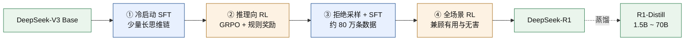

# LLM Atlas <Badge type="tip" text="全景速览" />

**LLM 训练算法知识图谱** —— 12 个章节、150 多页，从基座模型一路到 Agent 与 RSI。本站只收**讨论度高、工程上真正会用的出名算法**，不堆砌冷门变体，也不堆砌容易过期的 benchmark 数字。每个算法一页，结构统一：一句话定义 → 直觉与动机 → 方法与公式 → 与 baseline 的差异 → 实现要点 → 调参经验 → 参考文献。

[如何阅读本知识库 →](/guide/) · [后训练总览 →](/post-training/) · [动手学：各种 nano 项目 →](/guide/nano-projects) · [符号约定 →](/guide/notation)

## 整站地图

<AtlasMap />

## 这里面有什么

每章都有总览页（讲清脉络与选型），下面是各章实际收录的内容：

| 章节 | 回答什么问题 | 收了哪些 |
| --- | --- | --- |
| [基础模型](/base-models/) | 各家基座的架构取舍与定位 | Scaling Laws · Qwen · DeepSeek · GLM · Llama · Kimi · MiniMax · Step · Gemini · Claude · GPT |
| [模型架构](/architecture/) | Transformer 到底由哪些零件组成 | Transformer 拆解 · 注意力 · 稀疏注意力 · 位置编码与归一化 · MoE · VLM · 全模态 |
| [后训练总览](/post-training/) | SFT / 偏好 / RL / 蒸馏之间怎么选 | 两个正交维度 · 统一梯度视角 · 五家公开配方 · 按手里资源选方法 |
| ├ [SFT](/sft/) | 怎么让基座学会听指令、按格式答 | 全量微调 · 数据构造 · Chat Template · Packing · Loss Masking |
| ├ [LoRA 系列](/lora/) | 怎么用更少显存和参数完成微调 | LoRA · QLoRA · DoRA · AdaLoRA · rsLoRA · LoRA+ · PiSSA |
| ├ [DPO 系列](/dpo/) | 不训 RM、不跑在线 RL 怎么对齐偏好 | DPO · IPO · KTO · ORPO · SimPO · CPO |
| ├ [PPO / GRPO 系列](/rlhf/) | 怎么用奖励信号把能力继续往上推 | Reward Model · PPO · GRPO · DAPO · GSPO · CISPO · RLOO · REINFORCE++ · 训练循环机制 |
| └ [OPD / 蒸馏](/opd/) | 怎么把大模型的能力转移到小模型 | 大厂实践 · 白盒（MiniLLM / GKD / DistiLLM）· 黑盒（GAD）· 自蒸馏（OPSD / RLSD / SDFT）· 推理蒸馏 |
| [训练系统](/training-systems/) | 几千张卡怎么把模型训起来 | 数据并行 · 模型并行 · 显存与吞吐优化 |
| [推理模型](/reasoning/) | 长思维链是怎么被训出来的 | RLVR 可验证奖励 · PRM/ORM 过程奖励 · test-time scaling · 搜索 |
| [推理与解码](/inference/) | 训好的模型怎么跑得更快、更省显存 | KV Cache 与 PagedAttention · 量化（GPTQ / AWQ / FP8）· 投机解码 · 推理框架对比 |
| [评测](/eval/) | 怎么判断模型是真的变好了 | 基准与数据污染 · LLM-as-judge · Arena / Elo · Rubric 化评测 |
| [Agent](/agent/) | 模型训好之后怎么组织成能干活的系统 | Tool Use 训练 · Agentic RL · Harness 工程 · Skills · 代表框架 · Deep Research · 自主科研 Agent |
| [RSI](/rsi/) | 这层机器怎么自己优化自己 | 上下文工程 → 演化搜索 → 权重与 harness 联合演化 |
| [AIGC](/aigc/) | 另一条赛道：图像与视频生成 | 扩散基础 · Latent Diffusion · DiT 与 Flow Matching · 可控生成 · 加速采样 · 视频生成 |
| [导读与基础](/guide/) | 读正文之前需要的前置知识 | [符号约定](/guide/notation) · [概率论](/guide/probability) · [信息论](/guide/info-theory) · [GPU](/guide/gpu) · [A/B 与统计](/guide/ab-testing) · [nano 项目](/guide/nano-projects) |

## 一条真实的配方长什么样

光看章节列表容易觉得零散。实际训一个推理模型，是把上面好几章串起来用——下面是 DeepSeek-R1 的公开流程，每一步都能在本站找到对应页面：

对应阅读：① [SFT](/sft/) → ② [GRPO](/rlhf/grpo) 与 [RLVR](/reasoning/rlvr) → ③ [数据构造](/sft/data-construction) → ④ [RLHF 总览](/rlhf/)，蒸馏那步见 [推理蒸馏](/distillation/reasoning)。其他公开配方（InstructGPT、Llama 3、Tülu 3、Qwen3）在 [后训练总览](/post-training/) 里对照着列了出来。

## 从哪里开始

| 你是 | 怎么读 | 入口 |
| --- | --- | --- |
| **新手**，想先建立全局观 | 按主干走一遍，每章先读总览页 | [导读](/guide/) → [后训练总览](/post-training/) → [SFT](/sft/) → [DPO](/dpo/dpo) → [PPO](/rlhf/ppo) |
| **进阶**，想搞清家族内差异 | 横向对比同族变体，抓每页的「与 baseline 对比」表 | [DPO 系列](/dpo/) · [PPO/GRPO 系列](/rlhf/) · [LoRA 系列](/lora/) |
| **查表**，带着具体问题来 | ⌘K 搜索直达算法页，只看「方法与公式」「调参与实践经验」 | [符号约定](/guide/notation) · [信息论基础](/guide/info-theory) |
| **想动手**，不想只读公式 | 每层技术栈挑一个能读完的最小实现 | [动手学：各种 nano 项目](/guide/nano-projects) |

## 最近更新

| 时间 | 更新 |
| --- | --- |
| 2026-10 | [信息论基础](/guide/info-theory) 新增「互信息」；新增 [概率论基础](/guide/probability)；[A/B 与统计](/guide/ab-testing) 新增「离线评测分数的误差棒」 |
| 2026-10 | 蒸馏全部并入 [OPD 分组](/opd/)；[nano 项目页](/guide/nano-projects) 补多算法 RL 与 mini-sglang |
| 2026-09 | [OPD 章节重写](/opd/)（大厂实践 / 白盒 / 黑盒 / 自蒸馏 / 圆桌争议）；[Agent](/agent/) 按训练 · 工程 · 案例三层重组 |
| 2026-09 | 新增 [后训练分组与总览页](/post-training/)、[CISPO](/rlhf/cispo) 论文页 |
| 2026-07 | 新增 [Rubric 化评测](/eval/rubrics)、[RSI](/rsi/)，以及 Deep Research 多篇论文页 |

> 开源模型以技术报告 / 论文为准，闭源模型以官方博客 / 模型卡为准。内容有错漏欢迎去 [GitHub](https://github.com/zhoujx4/llm-atlas) 提 issue。
